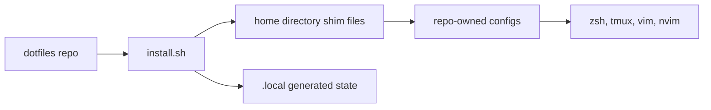

# Dotfiles Manual

This repo contains the configuration that makes a shell session feel like your
machine: zsh startup, aliases, functions, tmux, Vim, Neovim, and install
helpers.

The main idea is:

Use this manual as a map:

- [Repo structure](structure.md): what belongs where.
- [Installation](install.md): how files are connected into `$HOME`.
- [Zsh](zsh.md): shell startup, plugins, aliases, functions, agents.
- [Tmux](tmux.md): terminal multiplexer settings and plugin assumptions.
- [Vim and Neovim](vim.md): editor config and plugin setup.
- [Maintenance](maintenance.md): common edits with examples.

## Current Design

The repo keeps real configuration in source-controlled files. Installer scripts
create small shim files in your home directory that source those repo files.
Generated files, backups, and cloned plugins live under `.local/` and are not
part of the maintained source.

Update this page when a new major config area is added to the repo.
