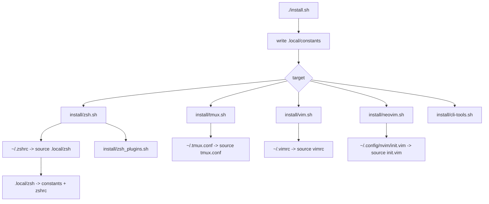

# Installation

Run the installer from the repo root:

```sh
./install.sh
```

Install everything:

```sh
./install.sh -a
```

Install one area:

```sh
./install.sh zsh
./install.sh tmux
./install.sh vim
./install.sh neovim
./install.sh cli-tools -n fzf
```

## Flow



## What Installers Do

- Back up existing home config files into `.local/backup/`.
- Create small home-directory shim files that source repo configs.
- Install or update zsh/tmux plugins where configured.
- Install selected CLI tools through a package manager when requested.

The installers are intentionally thin. Most behavior lives in the config files
they point to.

Update this page when a new install target is added or a shim path changes.
