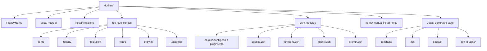

# Repo Structure

## Source-Controlled Files

- `install.sh` dispatches to installers in `install/`.
- `zshrc` is the interactive zsh entrypoint.
- `zsh/plugins.config.zsh` contains plugin lists used by installers and startup.
- `zsh/plugins.zsh` sources already-installed plugins during shell startup.
- `tmux.conf`, `vimrc`, and `init.vim` are the tool configs.
- `.gitconfig` is the tracked Git config for this dotfiles setup.
- `docs/` explains the repo and should change when behavior changes.

## Generated Or Local Files

- `.local/constants` records the absolute `DOTFILES` path.
- `.local/zsh` is the generated zsh shim sourced by `~/.zshrc`.
- `.local/backup/` stores backups made by installers.
- `.local/zsh_plugins/` stores cloned zsh plugins.
- `.env.local` stores machine-specific environment values.

These files should not be treated as portable source.

Update this page when files move, a new source-controlled directory is added, or
a generated file becomes part of the install flow.
