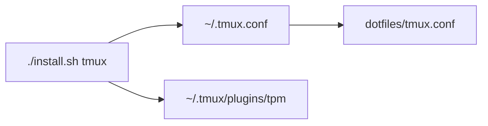

# Tmux

`install/tmux.sh` creates a home shim:

## What The Config Does

- Uses mouse support, vi copy mode, and one-based window/pane indexes.
- Keeps splits and new windows in the current pane path.
- Adds Vim-aware pane navigation.
- Configures a status bar with time, Docker, Kubernetes, Spotify, and tmux
  resurrect/continuum status.
- Uses TPM for tmux plugins.

## External Assumptions

Some status segments assume commands exist:

- `xclip` for clipboard integration.
- `docker` for Docker container count.
- `kubectl` for the current Kubernetes context.
- `dbus-send` and Spotify MPRIS metadata for `spotify_info.sh`.
- `/usr/share/tmux-resurrect/resurrect.tmux` if using distro-installed
  tmux-resurrect.

Update this page when keybindings, status bar dependencies, or plugin setup
changes.
