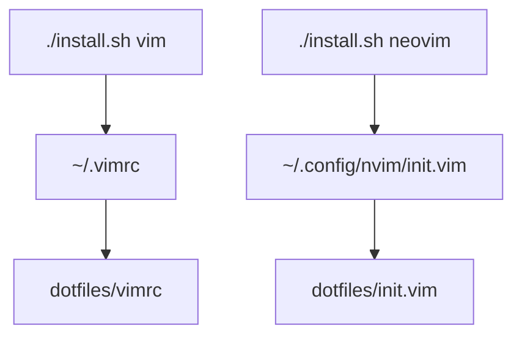

# Vim And Neovim

The Vim and Neovim configs are intentionally simple shims into repo files:



## Vim

`vimrc` contains basic editor defaults: line numbers, indentation, mouse support,
highlighted search, and faster terminal scrolling.

## Neovim

`init.vim` contains the same basic defaults plus vim-plug plugins:

- `vim-surround`
- `nerdtree`
- `vim-commentary`
- `vim-airline`
- `pgsql.vim`
- `vim-css-color`
- `awesome-vim-colorschemes`
- `coc.nvim`
- `vim-devicons`
- `vim-terminal`
- `tagbar`
- `vim-multiple-cursors`
- `suda.vim`

Install plugins from inside Neovim:

```vim
:PlugInstall
```

Update plugins:

```vim
:PlugUpdate
```

Update this page when editor plugins, required external tools, or important
keybindings change.
