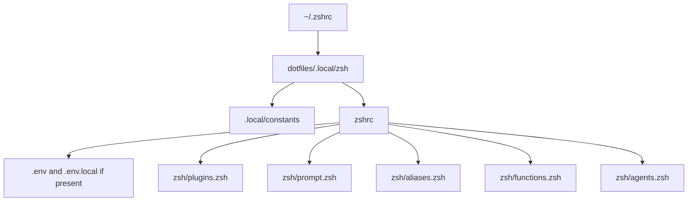

# Zsh

Zsh is loaded through a generated shim:



## Files

- `zshrc`: startup order, PATH, editor, fzf, pyenv, optional zoxide, and module sourcing.
- `zsh/plugins.config.zsh`: plugin lists used by installers and startup.
- `zsh/plugins.zsh`: sources plugins already present in `.local/zsh_plugins/`.
- `zsh/aliases.zsh`: command shortcuts.
- `zsh/functions.zsh`: shell functions such as `dots`, `ghc`, `s`, and helpers.
- `zsh/agents.zsh`: ssh-agent and gpg-agent startup.
- `zshenv`: zsh environment settings that should load before interactive zsh.

## Common Edits

Add an alias:

```zsh
alias gs="git status"
```

Add a GitHub zsh plugin:

```zsh
plugins=(
  "zsh-users/zsh-autosuggestions"
  "owner/plugin-name"
)
```

Then run:

```sh
./install.sh zsh-update
```

Put machine-specific values in `.env.local`, using `.env.example` as the
template. Keep personal paths out of tracked config unless they are intentionally
part of this repo.

Aliases under the Webkom section expect `WEBKOMCODE` to be set in `.env.local`.

`lsa` is a function, not a plain alias: it uses `eza` when available, then `lsd`,
then normal `ls -la`. This keeps directory listing usable on stock Ubuntu 22.04.

Optional jump helper:

```sh
./install.sh cli-tools -n zoxide
```

Then restart zsh and use `z partial-directory-name`.

Set this to avoid automatic tmux startup:

```sh
export DOTFILES_DISABLE_AUTO_TMUX=1
```

Update this page when zsh load order changes, a module is added, or plugin
management changes.
